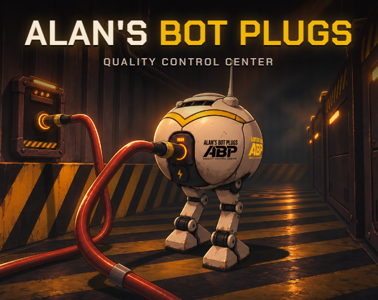
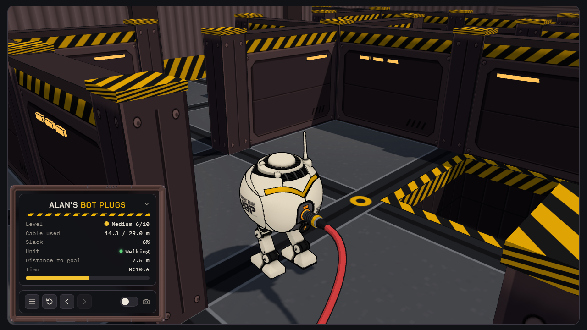
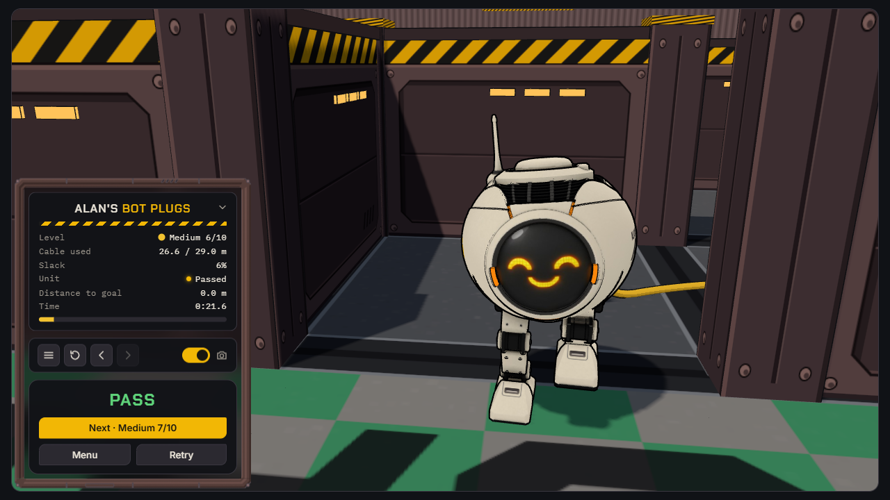
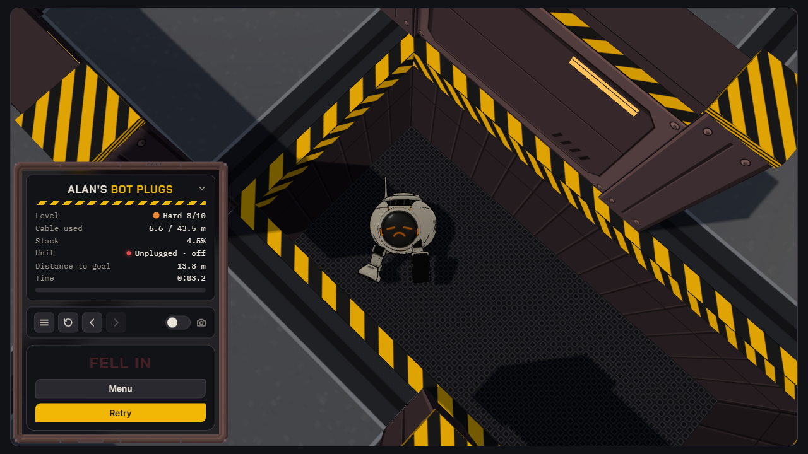
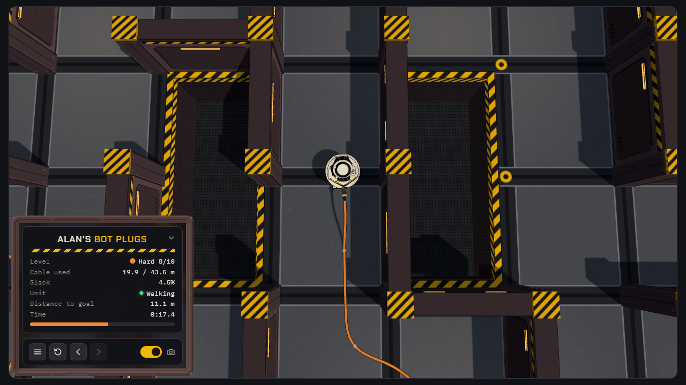
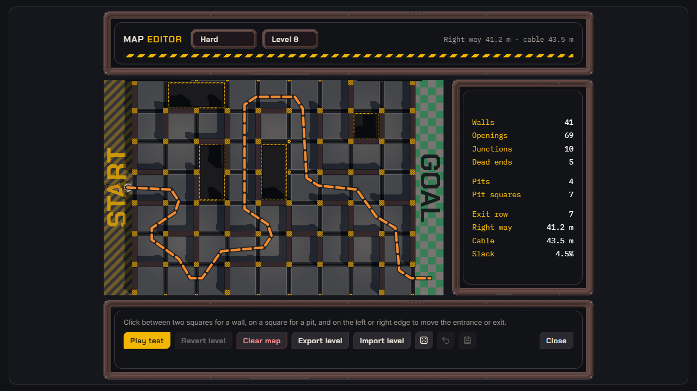
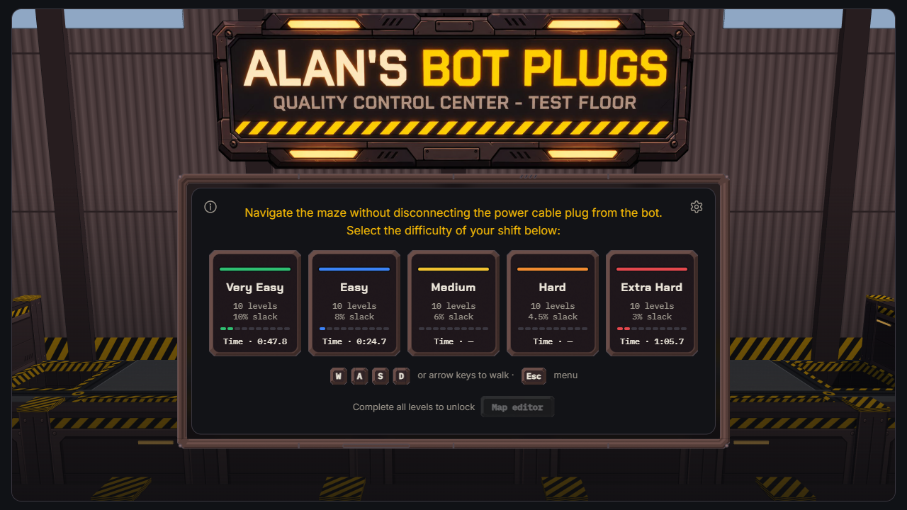

<p align="center">
  
</p>

<p align="center">
  <b>Walk a test bot through the maze without pulling its power plug from the wall.</b><br>
  <a href="https://tinymicrobe.itch.io/alans-bot-plugs">Play it free in your browser on itch.io</a>
</p>

---

Welcome to the test floor at Alan's Bot Plug factory. You're a quality control bot responsible for testing the strength of Alan's Bot Plugs. Each shift, you wind through a series of mazes, walking start to finish while plugged into the wall by your power cable.

The cable is only a little longer than the right way through: that's the slack. Take the long way round, and the plug pops out. Mind the pits, too. Clear all ten mazes of a given difficulty to finish your shift.

Pass every level to unlock the map editor, then build, play-test, and share your own mazes!

<table>
  <tr>
    <td></td>
    <td></td>
  </tr>
  <tr>
    <td></td>
    <td></td>
  </tr>
  <tr>
    <td></td>
    <td></td>
  </tr>
</table>

## Controls

### Keyboard

| Key | Action |
| --- | --- |
| <kbd>W</kbd> <kbd>A</kbd> <kbd>S</kbd> <kbd>D</kbd> or arrow keys | Walk and turn |
| <kbd>Esc</kbd> | Menu, or back |
| <kbd>Enter</kbd> | Yellow button action |
| <kbd>1</kbd> to <kbd>5</kbd> | Start a difficulty, from the menu |
| <kbd>E</kbd> | Map editor, from the menu |
| <kbd>←</kbd> <kbd>→</kbd> | Previous or next level, in the map editor |
| <kbd>Ctrl</kbd> <kbd>Z</kbd> | Undo, in the map editor |

### Touch

Hold your phone sideways (landscape).

| Touch | Action |
| --- | --- |
| Hold the left side | Walk and turn left |
| Hold the right side | Walk and turn right |
| Hold both sides | Walk straight |
| Menu, restart, and camera buttons | Menu, restart the level, and switch to the overhead camera |

Everything else is a tap on its button. On a touch screen, the game's About page shows these touch tips instead of the keyboard keys.

## Run it locally

The game is plain static files in `docs/` (HTML, CSS, JavaScript and [three.js](https://threejs.org/)), with no build step. GitHub Pages can serve the same folder. To play locally you need Python 3 and `make`:

```sh
make start    # serve the game at http://127.0.0.1:8807/
make stop     # stop the server
make itch     # pack docs/ into dist/alans-bot-plugs.zip for itch.io
```

When the game runs on the local server, the map editor shows a save button that writes your edits straight into `docs/levels.json`. Add `?editor` to the URL to open the editor before you've passed every level.

## Repository layout

- `docs/`: the game. `levels.json` holds the five difficulties and their fifty mazes.
- `tools/`: the local server and the itch.io packer.
- `art/`: source art, Blender scenes, audio, reference images and the itch.io page art in `art/itch/`.

## Made with AI

This game was made with generative AI. The art, 3D models, music and sound effects were AI-generated, and much of the code and text was written with AI help, then directed, edited, and play-tested by hand.

## License

Copyright 2026. See [LICENSE](LICENSE).
